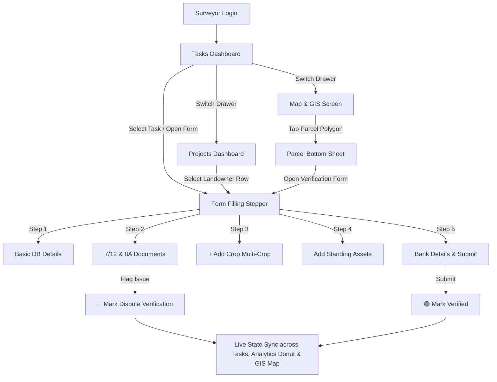

# SWADESH - Land Acquisition Management & Monitoring System
## Mobile Application Design System & Technical UI Specification

---

### 🏛️ 1. Executive Summary & Brand Identity

**SWADESH** is a modern, government-grade mobile application designed for the **Ministry of Rural Development, Government of India**. It empowers field personnel—collectively referred to as **Surveyors** (including Talathis, Junior Engineers, and Land Acquisition Officers)—to conduct ground verification of land parcels, inspect ownership documents, record standing agricultural and physical assets, report legal/boundary discrepancies, and visualize project corridors on interactive GIS maps.

#### Core Design Characteristics:
- **Government Authority & Trust**: Clean, minimal, high-contrast interface reflecting official government technological platforms.
- **Field Usability**: Large touch targets (minimum 48dp), clear typography, and high sunlight legibility for outdoor field operation.
- **Responsive & Overflow-Protected**: Layouts dynamically adapt across viewport dimensions (from Samsung S23 series to compact devices) with zero `RenderFlex` overflow errors.
- **Reactive State Sync**: Field status updates (e.g. marking a dispute) dynamically synchronize across Task Cards, Project Analytics, Landowner Tables, and GIS Map Polygons.

---

### 🎨 2. Color Palette & Design System Tokens

The color architecture is built around vibrant light bluish green / teal shades representing modern government authority, crisp neutral surfaces, and unambiguous status indicators.

| Design Token | Color Hex / Value | Purpose / Usage |
| :--- | :--- | :--- |
| **Primary Light Bluish Green** | `#00897B` | Global top navigation bar, primary buttons, card headers, active bottom navbar items |
| **Deep Teal Gradient** | `#004D40` | Login screen background & profile banner header background gradient |
| **Header Text Accent** | `#80CBC4` / `#FFFFFF` | "Ministry of Rural Development" title in top navigation bar |
| **Scaffold Background** | `#F1F5F9` | Clean neutral light slate background for maximum contrast |
| **Card Surface** | `#FFFFFF` | Material 3 surface with 2dp elevation shadow & 16dp rounded corners |
| **🟢 Verified Status** | `#2E7D32` | Emerald Green — Parcel verified with zero unresolved issues |
| **🟠 Pending Verification** | `#E65100` | High-Contrast Orange — Parcel assigned, pending field inspection |
| **🔴 Dispute Verification** | `#C62828` | Crimson Red — Discrepancy, boundary overlap, or ownership issue reported |

---

### 🧭 3. Global Navigation System

Every screen shares a consistent top navigation bar and Instagram-style bottom navigation bar for seamless accessibility in the field.

#### A. Global Top Navigation Bar (`SwadeshTopBar`)
- **Left**: Emblem Icon & Departmental branding title (`Ministry of Rural Development`) in white
- **Right**: Notification bell icon (🔔) with unread notification counter badge

#### B. Instagram-Style Bottom Navigation Bar (`SwadeshBottomNavigationBar`)
- **5 Bottom Navigation Items**:
  1. 📋 **Tasks**: `Projects land verification tasks`
  2. 📊 **Projects**: `Project analytics & parcel list`
  3. 📝 **Form**: `Field inspection & asset verification`
  4. 🗺️ **Map & GIS**: `Interactive land parcel GIS view`
  5. 👤 **Profile**: `Officer designation, personal details & session logout`

#### C. Officer Profile View (`OfficerProfileView`)
- **Prominent Post Header Card**: Displays Officer's **Official Post / Designation** (`Field Surveyor / Talathi`) prominently **ABOVE** personal details.
- **Officer Information Section**: Displays Name (**Rajesh Sharma**), Officer ID (**GOV-MH-SURV-4092**), Department (**Ministry of Rural Development**), Jurisdiction (**Pune Rural Division**), Contact details & Field Sync status.

---

### 📱 4. Screen-by-Screen Architecture & Specifications

#### 1. Surveyor Login Screen (`SurveyorLoginScreen`)
- **Purpose**: Authenticate Revenue Department field personnel before granting access to sensitive land records.
- **Layout**:
  - Official Revenue Department seal emblem badge.
  - Title: **SWADESH** — Land Acquisition Management System.
  - Surveyor Officer ID input (`SURV-MH-4092`) & Security Password / OTP.
  - Revenue Division Selector dropdown (Pune, Konkan, Nashik, Chhatrapati Sambhajinagar).
  - Security footer: *"Government of Maharashtra • Secure Portal"*.

---

#### 2. Screen 1 – Tasks Dashboard (`TasksDashboardView`)
- **Purpose**: Primary operational screen displaying assigned land verification tasks.
- **Top Search Bar**:
  - Pill-shaped rounded search container (`BorderRadius.circular(30)`) with soft shadow.
  - Placeholder: `"Search project_id..."` (supports landowner name, parcel ID, project ID, survey number).
- **Status Filter Chips**: `All Tasks`, `🟠 Pending`, `🔴 Dispute`, `🟢 Verified`.
- **1:1 Wireframe Matched Task Card Layout**:
  - **Header Row**: Project Name (bold, `#005A36`) on left | `Assigned by <Officer Name>` on right.
  - **Landscape Artwork Banner**: Custom painted scenic vector banner (`ScenicLandBannerPainter`) featuring puffy white clouds, light blue sky, and dual-tone rolling green hills (`#84CC16` & `#65A30D`).
  - **Middle Row**: Landowner Name & Parcel ID on left | **`Issue Notice`** dark green pill button on right (`#005A36`).
  - **Project Summary Section**: Header **`Land Acquisition project summary`** followed by detailed project text.
  - **Footer Row**: Status badge (🟢/🟠/🔴) & **`Open Form`** action button.

---

#### 3. Screen 2 – Projects Dashboard & Analytics (`ProjectsDashboardView`)
- **Purpose**: High-level project progress tracking and parcel search table.
- **Project Selector Card**:
  - Dropdown selector: Active Land Acquisition Project (e.g. *NH-48 Pune-Satara Expressway Widening Corridor*).
  - Displays Project ID and Total Affected Parcels count.
- **Project Analytics Section**:
  - Custom Donut Painter (`AnalyticsDonutPainter`) rendering live verification percentages:
    - 🟢 **Verified**: 50% (400 parcels)
    - 🟠 **Pending Verification**: 37.5% (300 parcels)
    - 🔴 **Dispute Verification**: 12.5% (100 parcels)
  - Color-coded legend with real-time stat counts.
- **Affected Landowner & Parcel List Table**:
  - Searchable list/table displaying Landowner Name, Parcel ID, Survey No., Village, Status Badge, and `Open Form` button.
  - **Click-to-Form Navigation**: Selecting any landowner row immediately opens the **Form Filling** screen with all details pre-populated!

---

#### 4. Screen 3 – Form Filling Stepper Interface (`FormFillingView`)
- **Purpose**: Primary field inspection interface supporting multi-step data entry.
- **5-Stage Stepper Header Bar**:
  `[1. Basic Details] ➔ [2. Ownership] ➔ [3. Agriculture] ➔ [4. Assets] ➔ [5. Bank Details]`
- **Step 1 — Basic Information**: Read-only DB pre-populated fields (Project Name, ID, Parcel ID, Survey No., Landowner Name, Village, Area) with `DB Auto-Fetched` badge.
- **Step 2 — Ownership & Document Verification**:
  - Official document cards (7/12 Satbara Extract, 8A Extract, Mutation Record) with `View Doc` high-res preview dialog.
  - **Discrepancy Reporting Box**: `⚠ MARK FOR DISPUTE VERIFICATION` button. Submitting immediately updates parcel status to 🔴 **Dispute Verification** across all screens, charts, and GIS maps.
- **Step 3 — Agricultural Data Collection (Multi-Crop Supported)**:
  - Prominent **`+ Add Crop`** button opening a modal dialog to record multiple crops per parcel.
  - Supports Sugarcane, Paddy/Rice, Cotton, Soybean, Wheat, Fruit Orchards, and Fallow Land.
  - Crop cards displaying cultivation area (Ha), expected yield (Tons), irrigation source, remarks, and delete trigger.
- **Step 4 — Asset Verification**:
  - Dynamic physical asset builder for standing trees (Mango, Teak), open wells, and farm structures.
  - Camera photo attachment preview badge (`Photo Attached`).
- **Step 5 — Bank Details & Submission**:
  - Landowner Aadhaar No., Bank Account No., IFSC Code, Bank Name.
  - Direct Benefit Transfer (DBT) verification notice and final `SUBMIT VERIFICATION` button (updates status to 🟢 **Verified**).

---

#### 5. Screen 4 – Map and GIS Screen (`MapGisView`)
- **Purpose**: Geographical visualization of land acquisition corridors and parcel verification statuses.
- **Features**:
  - Custom canvas painter (`GisMapCanvasPainter`) rendering land parcel boundary polygons.
  - Dynamic polygon status colors: 🟢 Green (Verified), 🟠 Orange (Pending), 🔴 Red (Dispute).
  - Project Filter dropdown (`Select Project ▼`) to isolate project corridors.
  - Map controls: Satellite / Vector layer toggle, recenter button, floating legend box.
  - **Interactive Parcel Bottom Sheet**: Tapping any parcel polygon opens a bottom sheet showing Parcel ID, Landowner, Survey No., Village, Status, and a direct `Open Verification Form` action button.

---

### 🔄 5. State Management & Connected User Flow

---

### 🛠️ 6. Codebase File Architecture

Per architectural requirements, the entire application frontend logic is consolidated within a clean, maintainable single-file structure:

- **[surveyor.dart](file:///c:/Users/hp/Downloads/mobile_frontend/lib/mobile_frontend/pages/surveyor.dart)**: Contains all Data Models (`LandParcel`, `Project`, `LandTask`, `OwnershipDoc`, `AssetRecord`, `CropRecord`, `NotificationItem`), Custom Painters (`AnalyticsDonutPainter`, `ScenicLandBannerPainter`, `GisMapCanvasPainter`), Navigation Bars, Side Drawer, Dialogs, Bottom Sheets, and Screen Views.
- **[main.dart](file:///c:/Users/hp/Downloads/mobile_frontend/lib/main.dart)**: Application entry point initializing `SwadeshApp`.
- **[widget_test.dart](file:///c:/Users/hp/Downloads/mobile_frontend/test/widget_test.dart)**: Automated widget test suite.

---

### 📦 7. Build & Deployment Artifacts

- **Android Debug Package**: `build/app/outputs/flutter-apk/app-debug.apk`
- **Execution Verification**: Verified via `flutter test` (`00:01 +1: All tests passed!`)
